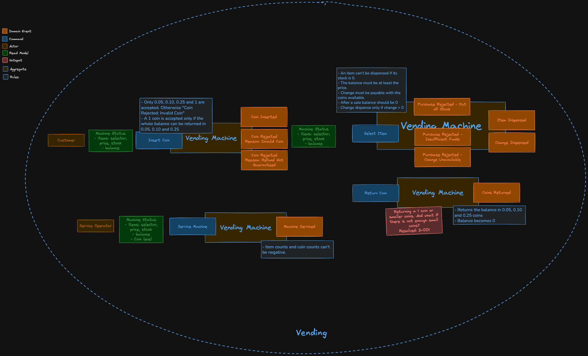

# Vending Machine

A vending machine in PHP, built with DDD and hexagonal architecture. It accepts coins, sells items, gives change, and is refilled by a service operator.

## Domain model

The event storming board: commands, events, rules and the Vending Machine aggregate. Code names match it.




## Requirements

- Docker with Docker Compose
- Make

## Run

```bash
make install
make service
```

Stock the machine, then type `EXIT`:

```
SERVICE, WATER=0.65x10, JUICE=1x5, SODA=1.50x8, 0.05x20, 0.10x20, 0.25x20
-> SERVICED
```

Then buy:

```bash
make vending
```

```
1, 0.25, 0.25, GET-SODA
-> SODA
0.10, 0.10, RETURN-COIN
-> 0.10, 0.10
1, GET-WATER
-> WATER, 0.25, 0.10
```

- Customer actions: `0.05`, `0.10`, `0.25`, `1`, `GET-<item>`, `RETURN-COIN`, `STATUS`.
- Operator actions: `SERVICE`, `STATUS`.
- `EXIT` or Ctrl+D closes a session. State is kept in `var/vending.sqlite`; delete it to start over.

## Test

Domain and application code were built with TDD (D-002): one behaviour per commit, test and code together, visible in the git log.

```bash
make test
make lint
make coverage
```

- Unit: the domain rules.
- Application: the use cases, over an in-memory repository.
- Integration: the SQLite repository and the consoles.
- Acceptance: the real CLI as separate processes, running the spec's examples.

## Architecture

- `src/Vending/{Domain,Application,Infrastructure}`: one bounded context (ADR-002); Deptrac enforces the layers.
- Domain: the `VendingMachine` aggregate holds the business rules; value objects (Money, Coin, Coins, Selector), the Item entity, the change calculator, and domain events, rejections included (D-008).
- Application: one handler per command, plus the Machine Status query.
- Infrastructure: the SQLite repository (ADR-001) and the CLI (ADR-003).

## Docs

- [DECISIONS.md](DECISIONS.md) and [ADRs](docs/adr): what was decided and why.
- [Glossary](docs/glossary.md), [foundations](docs/foundations.md), [roadmap](docs/roadmap.md).

## Known limitations

- Operators are not authenticated (ADR-003).
- One machine per process. Remote access, security and telemetry would come through a REST adapter calling the same handlers.
